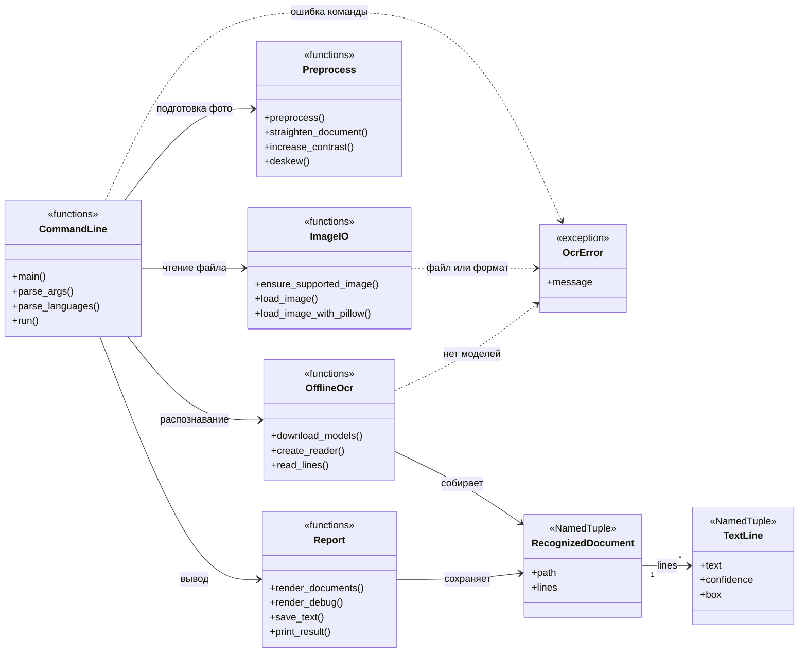
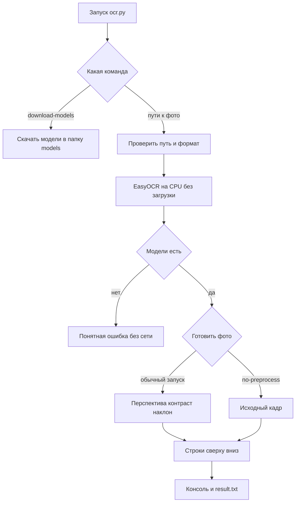
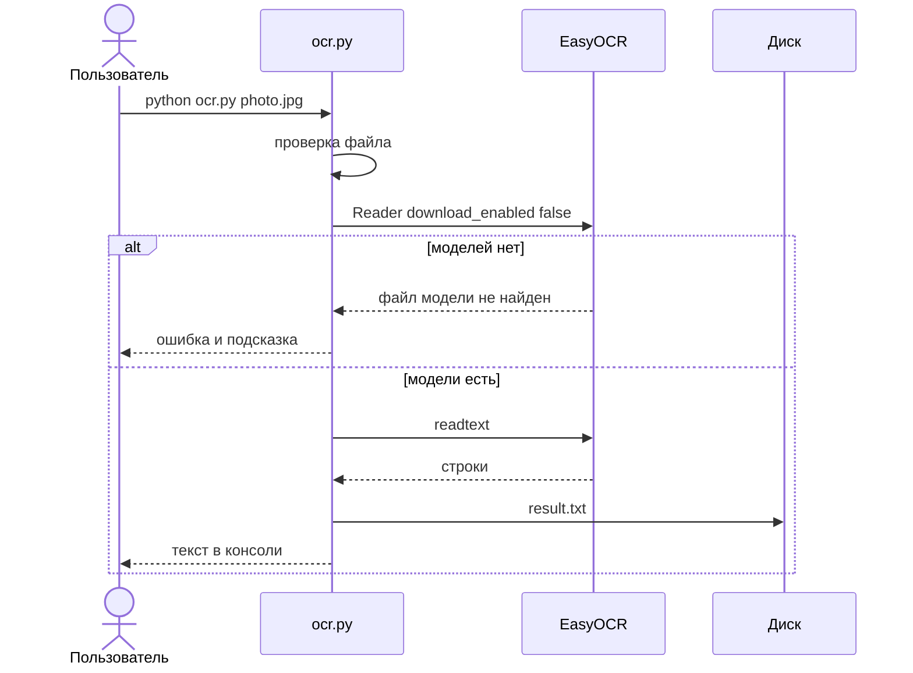

<h1 align="center">OCR документа A4</h1>

<p align="center">
  Локальная программа: фотография документа на входе, текст на русском и английском на выходе.
</p>

<p align="center">
  
  
  
</p>

<p align="center">
  <code>python ocr.py document.jpg</code>
</p>

> Программа не отправляет никакие данные в сеть и работает полностью локально.

Текст печатается в консоль и сохраняется в `result.txt` (UTF-8). Видеокарта не нужна.

## Содержание

- [Что умеет](#что-умеет)
- [Дизайн](#дизайн)
- [Установка](#установка)
- [Модели](#модели)
- [Запуск](#запуск)
- [Пример результата](#пример-результата)
- [Частые проблемы](#частые-проблемы)
- [Офлайн](#офлайн)
- [Состав](#состав)

## Что умеет

- Читает `.jpg`, `.jpeg`, `.png`, `.webp`, `.bmp`, в том числе путь с кириллицей.
- Распознаёт русский и английский текст. Язык задаётся аргументом `--lang`.
- Несколько фото за один запуск пишет в один файл.
- По желанию сохраняет координаты блоков и уверенность (`--debug`).
- Перед распознаванием слегка готовит фото. Жёсткую бинаризацию не делает: EasyOCR лучше читает серый кадр с поднятым контрастом.
- Если моделей нет, завершается с понятной ошибкой и сама ничего не скачивает.

## Дизайн

Вся программа — файл [`ocr.py`](ocr.py). Отдельных слоёв и сервисов нет: так проще пройти путь от аргумента командной строки до `result.txt`.

Классов поведения нет. Есть три типа данных и функции, собранные по обязанности. Диаграмма ниже показывает именно это, а не отдельную иерархию, которой в коде нет.

### Типы данных и обязанности



| Группа | Где смотреть | Что делает |
| --- | --- | --- |
| `CommandLine` | `main`, `parse_args`, `run` | Разбирает команду и выбирает ветку: загрузка моделей или распознавание. |
| `ImageIO` | `ensure_supported_image`, `load_image` | Проверяет путь и формат. Читает байты через `numpy`, чтобы Windows не теряла кириллицу в пути. |
| `Preprocess` | `preprocess` и функции ниже неё | Геометрия, затем шум и контраст, затем небольшой наклон. |
| `OfflineOcr` | `create_reader`, `read_lines` | EasyOCR на CPU. Сеть разрешена только в `download_models`. |
| `Report` | `render_documents`, `save_text` | Печатает текст и пишет UTF-8. В режиме `--debug` пишет второй файл. |
| `TextLine` | кортеж | Одна распознанная строка: текст, уверенность, четыре угла. |
| `RecognizedDocument` | кортеж | Файл и его строки в порядке чтения. |
| `OcrError` | исключение | Ошибка, которую можно показать человеку. Код выхода при ней равен 1. |

`box` у `TextLine` — четыре точки `(x, y)` в пикселях кадра, который ушёл в OCR.

### Поток одного запуска



Порядок внутри `preprocess` фиксирован:

1. Перспектива, только если найден отдельный четырёхугольник листа.
2. Серый цвет, слабое удаление шума, локальный контраст.
3. Поворот к горизонтали, только если наклон уверенный и небольшой.

Правила, по которым шаг можно пропустить:

| Проверка | Порог | Если не сошлось |
| --- | --- | --- |
| Доля площади контура | от 30% до 95% кадра | перспектива не применяется |
| Углы на границе кадра | все 4 угла ближе 2% к краю | это сам кадр, его не тянут |
| Узкий контур | короткая сторона меньше 20% длинной | контур отбрасывается |
| Наклон текста | от 0.4° до 15° | поворот не применяется |

Скан, который уже занимает весь кадр, остаётся как есть. Лист, снятый на столе и заметно отделённый от края фото, выравнивается.

### Где включается сеть



Ветка `python ocr.py --download-models` — единственная, где `download_enabled` равен true. Она не принимает пути к фото.

## Установка

Нужен Python 3.9 или новее.

Windows:

```bat
python -m venv .venv
.venv\Scripts\activate
pip install torch torchvision --index-url https://download.pytorch.org/whl/cpu
pip install -r requirements.txt
```

Первая команда `pip` ставит PyTorch без CUDA, чтобы не скачивать сборку для видеокарты. Интернет нужен на время установки пакетов и на одно скачивание моделей. Эти адреса относятся к установке, программа их не вызывает.

Зависимости перечислены в [`requirements.txt`](requirements.txt): EasyOCR, OpenCV, Pillow, NumPy. Torch ставится как зависимость EasyOCR.

## Модели

Файлы моделей лежат в папке `models` рядом с `ocr.py`. Пока их нет, обычный запуск не выходит в интернет.

Один раз, когда интернет есть:

```bat
python ocr.py --download-models
```

EasyOCR сохранит модели в `models`. После этого распознавание работает без сети. Повторять загрузку не нужно, пока не меняется набор языков. Для другого языка:

```bat
python ocr.py --download-models --lang ru
```

Папка `models` в git не входит: файлы большие, их получает команда загрузки.

## Запуск

```bat
python ocr.py path\to\document.jpg
python ocr.py path\to\document.jpg --lang ru+en
python ocr.py path\to\document.jpg -o result.txt
python ocr.py page1.jpg page2.png
python ocr.py document.jpg --debug
python ocr.py document.jpg --no-preprocess
```

| Аргумент | Назначение |
| --- | --- |
| `--lang ru+en` | Языки через `+` или запятую. По умолчанию `ru+en`. Повторы отбрасываются. |
| `-o result.txt` | Куда записать текст. По умолчанию `result.txt` в текущей папке. |
| `--debug` | Рядом пишется `result.debug.txt`: номер строки, уверенность и четыре угла. |
| `--no-preprocess` | Не менять геометрию и контраст. В OCR уходит исходный кадр. |
| `--download-models` | Один раз скачать модели. Пути к фото в этой команде не передаются. |

Несколько фото сохраняются в один файл. Перед текстом каждого стоит его имя:

```text
=== page1.jpg ===
Текст первой страницы

=== page2.png ===
Текст второй страницы
```

Один файл записывается без такого заголовка.

## Пример результата

```text
Распознанный текст:
Договор № 123 от 15.03.2025
...
Текст сохранён в result.txt
```

Если текста на фото нет, в файле будет строка `Текст не распознан.`

`--debug` для того же запуска даёт `result.debug.txt`:

```text
Файл: document.jpg
1. [0.98] Договор № 123 от 15.03.2025
    координаты: (120, 80), (640, 82), (638, 110), (118, 108)
```

Существующий файл результата заменяется.

## Частые проблемы

- Размытый кадр, блик и глубокая тень портят буквы. Снимайте лист целиком, при ровном свете, без вспышки в упор.
- Короткой стороне лучше быть не меньше 1000 пикселей. Мелкий текст на общем плане листа читается плохо.
- Сильно обрезанный или смятый лист программа не восстановит. Она поправляет только заметный контур листа и наклон до 15°.
- Если после подготовки текст стал хуже или обрезались поля, повторите запуск с `--no-preprocess`.
- Уверенно читается печатный текст. Рукопись не является целью программы.
- Путь с русскими буквами допустим. Если файл не открывается, проверьте расширение: допустимы `.jpg`, `.jpeg`, `.png`, `.webp`, `.bmp`. Пустой и повреждённый файл дают отдельную ошибку.

Код выхода `0` — текст записан. Код `1` — ошибка в консоли, `result.txt` при этом не создаётся.

## Офлайн

Программа не отправляет никакие данные в сеть и работает полностью локально.

Во время распознавания нет обращений к облачным OCR, телеметрии, проверки обновлений и скрытой загрузки моделей. Изображение и распознанный текст остаются на этом компьютере.

Сеть используется только если вы сами запустили:

```bat
python ocr.py --download-models
```

При первом таком запуске EasyOCR скачивает модели. После этого интернет для работы программы не нужен. Если моделей нет, обычный запуск показывает ошибку и не пытается подключиться.

В коде `ocr.py` нет адресов сервисов, ключей и облачных OCR.

## Проверка

Минимальный smoke без установки pytest:

```bat
python -m unittest tests.test_smoke -v
```

Тест полного OCR пропускается, пока нет файлов в `models`. После `python ocr.py --download-models` он тоже выполняется.

## Состав

```text
ocr.py              программа
requirements.txt    зависимости
README.md           эта инструкция
.gitignore          models, result.txt и служебные файлы Python
samples/            пример изображения для smoke
tests/              минимальные smoke-тесты
models/             появляется после загрузки моделей
```
