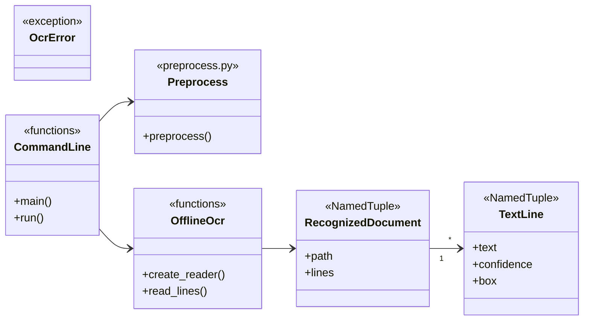

<h1 align="center">A4 Document OCR</h1>

<p align="center">
  Local app: document photo in, Russian/English text out.
</p>

<p align="center">
  
  
  
</p>

<p align="center">
  <code>DocOCR.bat</code> · <code>python ocr.py document.jpg</code>
</p>

> The program does not send any data to the network and runs fully locally.

Text is saved to `result.txt` (UTF-8). No GPU required.

UI language defaults to **Russian**. Switch to English in the GUI combo box, or with CLI `--ui en`. Code comments and this README are in English.

## For end users (Windows)

1. Download the zip from [Releases](https://github.com/ursusandwolf/doc-photo-ocr/releases) and unpack it.
2. Run `start.bat` (or `DocOCR.vbs` / `DocOCR.bat`).
3. If libraries are missing — **Install libraries** (internet once).
4. If models are missing — **Download models** (internet once).
5. Drop a photo or folder (or use the buttons) — get `result.txt`.

If the machine already has Python 3.9+ with tkinter, the app uses it and does **not** reinstall Python.  
A second launch does **not** re-run `pip` or re-download models when `.venv` and `models` are ready.  
The `runtime` folder in the release is a fallback Python when no system Python exists.

## Features

- GUI: one-click setup, drag-and-drop, Ctrl+V paste, copy result, RU/EN UI, light / gray / dark themes.
- CLI batch mode: files, folders, `--per-file`, `--recursive`.
- Formats: `.jpg`, `.jpeg`, `.png`, `.webp`, `.bmp` (Cyrillic paths OK).
- OCR language default: Russian (`--lang ru`; add `+en` when needed).
- Light preprocessing (no hard binarization).
- Missing models → clear error, no silent network calls.

## How recognition works

One EasyOCR pipeline (not separate “pick a model” modes in the GUI):


1. [`preprocess.py`](preprocess.py) — alignment/contrast (disable with `--no-preprocess`).
2. **Detect** (CRAFT) — text boxes on the page.
3. Boxes are clustered into rows ([`read_lines`](ocr.py)).
4. **Recognize** (CRNN) — text per row.
5. Post-process in [`spellcheck.py`](spellcheck.py).

Detect and recognize use **different weights**, but always run **together** in one `easyocr.Reader`. There is no GUI switch for “detect only” or an alternate model.

| What | Where | Behavior |
|---|---|---|
| OCR languages | `--lang` (CLI), default `ru` | Passed to `Reader(['ru'])` or `Reader(['ru','en'])` |
| UI language | `--ui` / GUI combo | Labels only, not models |

With `--lang ru+en`, EasyOCR keeps one shared reader with several recognition dictionaries and reads mixed text in a **single** pass (not two separate runs). Weights live in [`models/`](models/) (`.pth`); download with `python ocr.py --download-models`.

What you can change today:

- CLI: `python ocr.py --lang ru` or `--lang ru+en` (and other EasyOCR codes).
- GUI worker uses CLI defaults (`DEFAULT_LANGUAGES`) — no model picker in the window.
- Post-process options (spell, caps, junk) are not OCR models.

## Possible evolution: other OCR engines

The app is **not** plugin-ready yet: EasyOCR is hard-wired in `create_reader` / `read_lines` / the GUI worker. Shared pieces that already help a future split:

- `TextLine` / `RecognizedDocument` — engine-agnostic DTOs
- `OcrError` + `i18n` keys — one place for user-visible failures
- `preprocess.py` / `spellcheck.py` — stay outside the engine

A practical next shape (only when a second engine is real pain):

1. Introduce an `OcrEngine` protocol (**Strategy**): `recognize(image) -> list[TextLine]`.
2. Keep EasyOCR as the default implementation; add Tesseract (or another) behind the same contract.
3. Factory / CLI–GUI flag picks the engine; worker stays one process per engine if models are heavy.
4. Optional quality score (% dictionary hits, junk density) → offer **re-run with another engine**, or auto-pick the better pass.

### Choosing an engine by size and speed

Rough CPU / offline profile for this product (photos of A4, not a benchmark suite):

| Engine | Disk / install | Cold start | Page speed | Fit |
|---|---|---|---|---|
| **EasyOCR** (current) | ~90+ MB weights + PyTorch | Slow (tens of seconds) | Moderate; cost grows with box count | Phone photos, RU/EN in one reader |
| **Tesseract** | Smaller tessdata; needs `tesseract.exe` on Windows | Fast | Often faster on clean scans | Scans/PDF-like pages; weaker on skewed photos |
| **Both (compare)** | Sum of the above | Worst of both if warmed together | 2× recognition time | Retry when score is low; pick higher dictionary agreement |

Selection policy worth encoding later:

- **Default:** EasyOCR (photo-first, already shipped).
- **Fast / small path:** Tesseract when the user opts in or when install size matters more than photo robustness.
- **Quality path:** run A, score; if below threshold, offer B and keep the better text (line- or document-level vote).

Do not add Strategy/Factory until a second backend is scheduled — the DTOs and `OcrError` boundary are enough for now. Tesseract / dual-engine is **deferred** (not part of the clipboard/invert UX work). Feature map vs [OCR-CopyPastePad](https://github.com/FlyingFathead/OCR-CopyPastePad): [`docs/compare-copypastepad.md`](docs/compare-copypastepad.md) (ideas only — no upstream license to copy code).

## Design

Core: [`ocr.py`](ocr.py) + [`preprocess.py`](preprocess.py). Window: [`gui.py`](gui.py). UI strings: [`i18n.py`](i18n.py) (ru default / en).



## Installation (developers)

Python 3.9+.

```bat
python -m venv .venv
.venv\Scripts\activate
pip install torch torchvision --index-url https://download.pytorch.org/whl/cpu
pip install -r requirements.txt
```

## Models

```bat
python ocr.py --download-models
```

Weights go to `models/`. After that, recognition is offline.

## CLI

```bat
python ocr.py path\to\document.jpg
python ocr.py path\to\document.jpg --lang ru+en
python ocr.py path\to\document.jpg -o result.txt
python ocr.py page1.jpg page2.png
python ocr.py resources\
python ocr.py resources\ --per-file
python ocr.py scans\ --recursive -o batch.txt
python ocr.py --ui en document.jpg
python ocr.py document.jpg --debug
python ocr.py document.jpg --no-preprocess
```

| Argument | Meaning |
| --- | --- |
| paths | Files and/or folders |
| `--recursive` | Also scan nested folders |
| `--per-file` | Write `name.txt` next to each image |
| `--ui ru\|en` | UI language (default `ru`) |
| `--lang ru` | OCR languages (default `ru`; use `ru+en` for mixed text) |
| `-o result.txt` | Shared output (ignored with `--per-file`) |
| `--debug` | Coordinates + confidence |
| `--no-preprocess` | Skip geometry/contrast |
| `--download-models` | One-time model download |

## Sample fixtures

Modern office samples with fictional data live in [`resources/`](resources/): application, employment certificate, delivery note. See [`resources/SOURCES.md`](resources/SOURCES.md).

## Common issues

- Blur, glare, and deep shadows hurt accuracy. Shoot the full page under even light.
- Short side preferably ≥ 1000 px.
- Severely cropped pages will not be reconstructed; only mild perspective/skew is fixed.
- If preprocess hurts quality, retry with `--no-preprocess`.
- Printed text is the target; handwriting is not.

## Offline

The program does not send any data to the network and runs fully locally.

Network is used only for `pip` / `--download-models` / the GUI install buttons. Recognition uses `download_enabled=False`.

## Tests

```bat
python -m unittest tests.test_smoke -v
```

## Layout

```text
DocOCR.bat          Windows GUI launcher
gui.py              setup + drag-and-drop UI
ocr.py              CLI + OCR engine
preprocess.py       image prep
i18n.py             RU/EN user-facing strings
requirements.txt
resources/          modern office fixtures
tests/
models/             after --download-models
.venv/              after Install libraries
runtime/            release zip only
```
