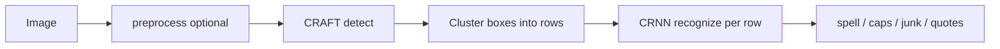
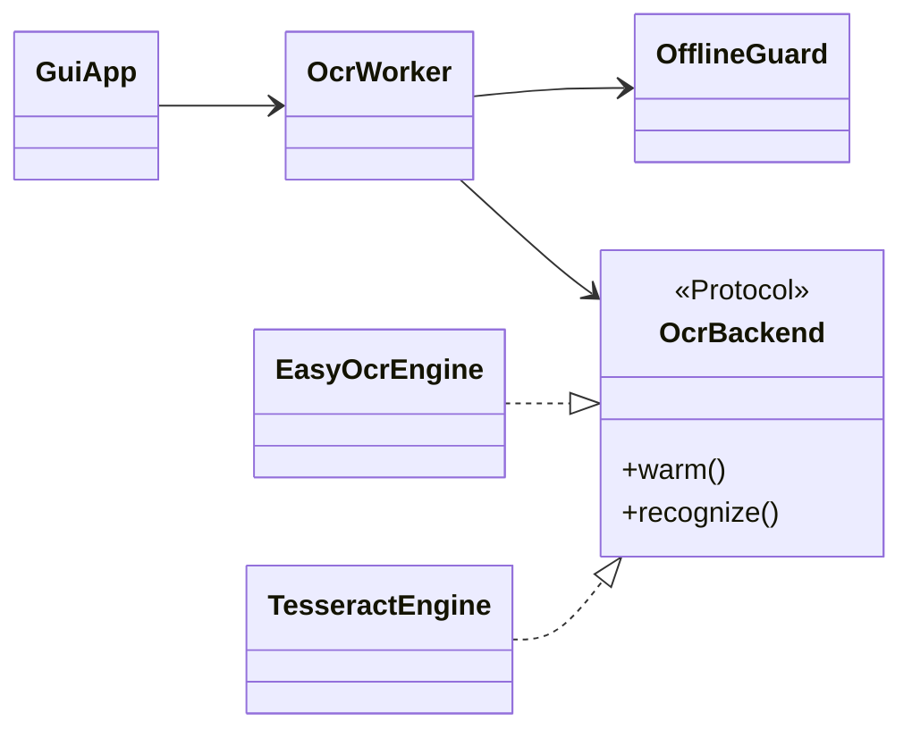

<h1 align="center">A4 Document OCR</h1>

<p align="center">
  Local app: document photo in, Russian/English text out.
</p>

<p align="center">
  
  
  
</p>

<p align="center">
  <code>DocOCR.bat</code> · <code>python ocr.py document.jpg</code>
</p>

> Photos and OCR text never leave the machine. Network is used only for explicit setup buttons (see [Offline / network security](#offline--network-security)).

Text is saved to `result.txt` (UTF-8). No GPU required.

UI language defaults to **Russian**. Switch to English in the GUI combo box, or with CLI `--ui en`. Code comments and this README are in English.

## For end users (Windows)

1. Download the zip from [Releases](https://github.com/ursusandwolf/doc-photo-ocr/releases) and unpack it.
2. Run `start.bat` (or `DocOCR.vbs` / `DocOCR.bat`).
3. If libraries are missing — **Install libraries** (internet once).
4. If models are missing — **Download models** (internet once).
5. Optional: **Install Tesseract** (internet + UAC). The app shows the official GitHub URL and pinned SHA-256 first — Windows may still say “Unknown publisher” because the UB-Mannheim NSIS build is often unsigned.
6. Drop a photo or folder (or use the buttons) — get `result.txt`.

If the machine already has Python 3.9+ with tkinter, the app uses it and does **not** reinstall Python.  
A second launch does **not** re-run `pip` or re-download models when `.venv` and `models` are ready.  
The `runtime` folder in the release is a fallback Python when no system Python exists.

## Features

### GUI

- One-window setup: **Install libraries**, **Download models**, **Install Tesseract**; bottom status bar (green = ready, red = missing).
- Drag-and-drop (after `windnd` install), file/folder pickers, **Ctrl+V** clipboard image paste.
- Copy result to clipboard; open result file.
- Engine combo: `easyocr` (default) or `tesseract` (restarts the OCR worker; prompts to install if missing).
- Layout combo: `plain` (default prose, word-by-word / line-by-line) or `table` (wide cell gaps).
- RU/EN UI; light / gray / dark themes (prefs saved locally).
- Post-process toggles: spelling, odd caps, junk strip (off by default), invert colors.
- Progress for model warm-up and recognition; long-lived OCR worker so EasyOCR stays in memory.

### CLI

- Batch: files, folders, `--per-file`, `--recursive`.
- `--engine easyocr|tesseract`, `--layout plain|table`, `--lang`, `--ui`, `--invert`, `--no-preprocess`, spell/caps/junk flags, `--debug`.
- Formats: `.jpg`, `.jpeg`, `.png`, `.webp`, `.bmp` (Cyrillic paths OK).

### Engines and polish

- **EasyOCR** (default): CRAFT detect + CRNN recognize; weights in `models/`.
- **Tesseract** (optional): Strategy backend in [`engines.py`](engines.py); GUI installs UB-Mannheim via silent NSIS + UAC ([`tesseract_setup.py`](tesseract_setup.py)), or uses a system `tesseract.exe`.
- Shared post-process in [`spellcheck.py`](spellcheck.py) (offline dictionaries + `dicts/`).
- Light preprocessing in [`preprocess.py`](preprocess.py) (no hard binarization).

### Security / offline

- Recognition never uploads photos or text.
- `download_enabled=False` for EasyOCR on every recognize/worker path.
- [`offline_guard.py`](offline_guard.py): during warm + recognize, any `urllib.request.urlopen` is blocked (`err.offline_blocked`).
- Network only on explicit setup (pip / models / Tesseract). Details: [Offline / network security](#offline--network-security) and [`docs/offline-security.md`](docs/offline-security.md).

## How recognition works

One EasyOCR pipeline (not separate “pick a model” modes in the GUI):



1. [`preprocess.py`](preprocess.py) — alignment/contrast (disable with `--no-preprocess`).
2. **Detect** (CRAFT) — text boxes on the page.
3. Boxes are clustered into rows ([`group_lines_into_rows`](ocr.py)): `--layout plain` (default) keeps near-X neighbors only; `table` allows wide cell gaps. Page skew + residual tilt, column gutters; Tesseract seeds from native `line_num` then refines the same way.
4. **Recognize** (CRNN) — text per row (L→R sort; debug log if order changed).
5. Post-process in [`spellcheck.py`](spellcheck.py).

Detect and recognize use **different weights**, but always run **together** in one `easyocr.Reader`. There is no GUI switch for “detect only” or an alternate model.

| What | Where | Behavior |
|---|---|---|
| OCR languages | `--lang` (CLI), default `ru` | Passed to `Reader(['ru'])` or `Reader(['ru','en'])` |
| UI language | `--ui` / GUI combo | Labels only, not models |

With `--lang ru+en`, EasyOCR keeps one shared reader with several recognition dictionaries and reads mixed text in a **single** pass (not two separate runs). Weights live in [`models/`](models/) (`.pth`); download with `python ocr.py --download-models`.

What you can change today:

- CLI: `--lang ru` / `ru+en`, `--engine easyocr|tesseract`.
- GUI: engine combo + post-process toggles (spell, caps, junk, invert).
- Post-process options are not OCR models.

## Engines (EasyOCR + Tesseract)

Phase 1 Strategy is in [`engines.py`](engines.py): both backends return `TextLine`. CLI `--engine` / GUI combo pick the engine; the worker loads one backend per process.

| Engine | Disk / install | Cold start | Fit |
|---|---|---|---|
| **EasyOCR** (default) | ~90+ MB weights + PyTorch | Slow | Phone photos (needs QC — see notes) |
| **Tesseract** | Smaller; GUI **Install Tesseract** or system binary | Fast | Prefer for current document photos |

Tesseract lookup: `TESSERACT_CMD` → `tesseract_cmd.txt` → `PATH` → `%LOCALAPPDATA%\DocOCR\tesseract` → `C:\Program Files\Tesseract-OCR\`.

| Scenario | EasyOCR | Tesseract |
|---|---|---|
| Manual QC 2026-11-10 (same images) | More token junk | **Good quality** |
| Phone photo A4 | Designed for this; verify per sample | Try if EasyOCR is noisy |
| Clean scan / print | Often weaker on digits/`№` | Strong |
| Cold start / RAM | Slow / heavy | Faster / lighter |

Manual QC + EasyOCR analysis backlog: [`docs/engine-quality-notes.md`](docs/engine-quality-notes.md).  
Compare notes vs [OCR-CopyPastePad](https://github.com/FlyingFathead/OCR-CopyPastePad): [`docs/compare-copypastepad.md`](docs/compare-copypastepad.md).

Possible later: score both engines and keep the better pass (not implemented).

## Design

| Module | Role |
|---|---|
| [`gui.py`](gui.py) | Setup UI, DnD, engine combo, worker control |
| [`ocr.py`](ocr.py) | CLI, worker protocol, EasyOCR helpers |
| [`engines.py`](engines.py) | Strategy: EasyOCR / Tesseract → `TextLine` |
| [`preprocess.py`](preprocess.py) | Geometry / contrast / invert |
| [`spellcheck.py`](spellcheck.py) | Offline polish |
| [`tesseract_pins.py`](tesseract_pins.py) | Pinned installer/tessdata URLs + SHA-256 |
| [`tesseract_setup.py`](tesseract_setup.py) | Detect + local Tesseract install |
| [`offline_guard.py`](offline_guard.py) | Block `urlopen` during OCR |
| [`i18n.py`](i18n.py) | RU/EN strings |
| [`errors.py`](errors.py) | `OcrError` |



## Installation (developers)

Python 3.9+.

```bat
python -m venv .venv
.venv\Scripts\activate
pip install torch torchvision --index-url https://download.pytorch.org/whl/cpu
pip install -r requirements.txt
```

## Models

```bat
python ocr.py --download-models
```

Weights go to `models/`. After that, recognition is offline.

## CLI

```bat
python ocr.py path\to\document.jpg
python ocr.py path\to\document.jpg --lang ru+en
python ocr.py path\to\document.jpg -o result.txt
python ocr.py page1.jpg page2.png
python ocr.py resources\
python ocr.py resources\ --per-file
python ocr.py scans\ --recursive -o batch.txt
python ocr.py --ui en document.jpg
python ocr.py document.jpg --engine tesseract
python ocr.py document.jpg --debug
python ocr.py document.jpg --no-preprocess --invert
```

| Argument | Meaning |
| --- | --- |
| paths | Files and/or folders |
| `--recursive` | Also scan nested folders |
| `--per-file` | Write `name.txt` next to each image |
| `--engine easyocr\|tesseract` | OCR backend (default `easyocr`) |
| `--ui ru\|en` | UI language (default `ru`) |
| `--lang ru` | OCR languages (default `ru`; use `ru+en` for mixed text) |
| `-o result.txt` | Shared output (ignored with `--per-file`) |
| `--debug` | Coordinates + confidence |
| `--no-preprocess` | Skip geometry/contrast |
| `--invert` | Invert colors before OCR |
| `--download-models` | One-time EasyOCR model download |

## Sample fixtures

Modern office samples with fictional data live in [`resources/`](resources/): application, employment certificate, delivery note. See [`resources/SOURCES.md`](resources/SOURCES.md).

## Common issues

- Blur, glare, and deep shadows hurt accuracy. Shoot the full page under even light.
- Short side preferably ≥ 1000 px.
- Severely cropped pages will not be reconstructed; only mild perspective/skew is fixed.
- If preprocess hurts quality, retry with `--no-preprocess`.
- Printed text is the target; handwriting is not.

## Offline / network security

**Policy:** user photos and OCR text never leave the PC.

| Path | Network? | Guard |
|---|---|---|
| CLI / GUI recognition + worker warm | No | `download_enabled=False` + [`offline_guard.offline_session`](offline_guard.py) blocks `urlopen` |
| Spellcheck / preprocess | No | Local only |
| **Install libraries** | Yes (user click) | `pip` + `download.pytorch.org` (subprocess; not via OCR guard) |
| **Download models** / `--download-models` | Yes (user click) | EasyOCR CDN (GitHub JaidedAI releases) |
| **Install Tesseract** | Yes (user click + UAC) | Official GitHub asset + pinned SHA-256; silent NSIS into LocalAppData + eng/rus tessdata (URLs below) |

### Tesseract download sources (pinned constants)

**Policy:** DocOCR never downloads “latest” Tesseract at runtime. URLs and SHA-256 digests are **frozen constants** in [`tesseract_pins.py`](tesseract_pins.py). Upstream can release newer builds; this app keeps using the pinned files until a maintainer updates that module (and this table) together.

| Constant | Current value |
|---|---|
| `TESSERACT_RELEASE_PAGE` | https://github.com/tesseract-ocr/tesseract/releases/tag/5.5.3 |
| `TESSERACT_SETUP_URL` | https://github.com/tesseract-ocr/tesseract/releases/download/5.5.3/tesseract-ocr-w64-setup-5.5.3.20260724.exe |
| `TESSERACT_SETUP_SHA256` | `bee9e3434bd94fd65387d9be28cd467a41f61b1275383b55b0f59a1331270ae4` |
| `TESSDATA_ENG_URL` | https://github.com/tesseract-ocr/tessdata/raw/main/eng.traineddata |
| `TESSDATA_ENG_SHA256` | `daa0c97d651c19fba3b25e81317cd697e9908c8208090c94c3905381c23fc047` |
| `TESSDATA_RUS_URL` | https://github.com/tesseract-ocr/tessdata/raw/main/rus.traineddata |
| `TESSDATA_RUS_SHA256` | `681be2c2bead1bc7bd235df88c44e8e60ae73ae866840c0ad4e3b4c247bd37c2` |

Hosts allowed: `github.com/tesseract-ocr` only. After download, SHA-256 must match or install aborts.  
GUI trust dialog: clickable release/file links, **Copy hash**, VirusTotal for the digest, then UAC.

**Bump procedure:** edit [`tesseract_pins.py`](tesseract_pins.py) → recompute hashes → update this README table → commit.

How the OCR guard works:

1. GUI/CLI start recognition or warm the worker.
2. Code enters `with offline_session():`.
3. Any accidental `urllib.request.urlopen(...)` raises `OcrError` (`err.offline_blocked`) instead of talking to the network.
4. Setup buttons intentionally run **outside** that context so models/Tesseract can still be downloaded when you ask.

Verify:

```bat
python -m unittest tests.test_smoke.OfflineGuardTests -v
```

Full matrix: [`docs/offline-security.md`](docs/offline-security.md). After setup, recognition works with Wi‑Fi off.

## Tests

```bat
python -m unittest tests.test_smoke -v
```

## Layout

```text
DocOCR.bat          Windows GUI launcher
gui.py              setup + drag-and-drop UI
ocr.py              CLI + worker + EasyOCR helpers
engines.py          EasyOCR / Tesseract Strategy
tesseract_pins.py   pinned Tesseract URLs + SHA-256
tesseract_setup.py  detect + local Tesseract install
offline_guard.py    block urlopen during OCR
preprocess.py       image prep
spellcheck.py       offline polish
errors.py           OcrError
i18n.py             RU/EN strings
docs/offline-security.md
requirements.txt
resources/          modern office fixtures
tests/
models/             after --download-models
.venv/              after Install libraries
runtime/            release zip only
```
